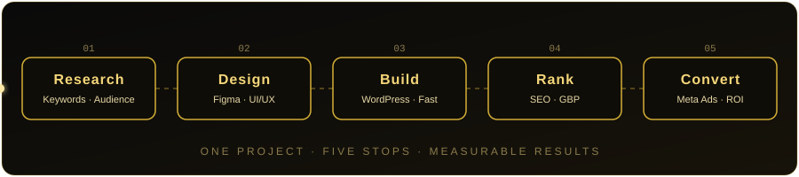

<div align="center">



<br/>

[](https://rakib-hossain.netlify.app/)
[](https://linkedin.com/in/fmahbub)
[](mailto:mahbubrakib695@gmail.com)
[](https://rakib-hossain.netlify.app/)


**From keyword to conversion, I build the whole growth funnel.**


</div>

```bash
$ whoami
rakib-hossain — Digital Marketing Executive · Web Designer · Bangladesh 🇧🇩

$ cat focus.txt
SEO · Local SEO · Meta Ads · WordPress · Conversion-focused web design

$ uptime --principles
results · clarity · speed · trust

$ status
● open to remote work & freelance projects
```

<div align="center">

## ⚡ One Project, Five Stops



</div>


## 👑 Profile

| | |
|---|---|
| **Role** | Digital Marketing Executive · SEO, Local SEO & Meta Ads Specialist |
| **Base** | Dhaka, Bangladesh 🇧🇩 |
| **Currently** | Web Design for Freelancing — **NHRDF, Level 3** (in training) |
| **Background** | Self-taught since 2020 · formal training at Creative IT Institute · BBA (Management), Mirpur College |
| **Founder** | MiniTech BD — e-commerce, landing pages & Meta ad copy |
| **Languages** | Bangla (native) · English (professional) · Japanese (N5, learning) |
| **Obsessions** | Local rankings · Fast, clean websites · Ads that pay back |


## 🧰 Toolkit

<div align="center">

**Marketing**


**Web Design & Build**


**Workflow**


</div>


## 🎓 Now Learning

> **Web Design for Freelancing — Level 3 · NHRDF**
> Turning my marketing background into complete client-ready websites: design, build, speed and SEO in one delivery.


## 🛠 Featured Work

<table>
<tr>
<td width="50%" valign="top">

### 🛒 MiniTech BD
*E-commerce brand for Bangladesh*

Product landing pages and Meta ad copy built to turn clicks into orders.

`Landing Pages` · `Meta Ads` · `Copywriting`

</td>
<td width="50%" valign="top">

### 🌐 Portfolio Website
*My personal showcase*

Clean, fast and mobile-friendly site presenting my services and results.

`Netlify` · `Responsive` · `SEO-ready`

[🔗 Live site](https://rakib-hossain.netlify.app/)

</td>
</tr>
</table>

<!-- Add your best Web Design projects here as you complete NHRDF assignments -->


## 📐 How I Work

- **Results first:** every page, post and ad has one measurable goal.
- **Fast by default:** lightweight pages, compressed images, clean code.
- **Local-first SEO:** Google Business Profile, citations and reviews that win the map pack.
- **Clear communication:** simple reports, honest timelines, no jargon.


## 📊 GitHub Pulse

<div align="center">

<!-- Replace fmhossain01 everywhere below -->


<br/><br/>


</div>


## 🤝 Let's Build Something

Open to **remote roles** and **freelance projects** in SEO, Local SEO, Meta Ads and web design.

```js
const reachOut = () => ({
  portfolio: "https://rakib-hossain.netlify.app/",
  linkedin:  "https://linkedin.com/in/fmahbub",
  email:     "mahbubrakib695@gmail.com",
});
```

<div align="center">


<br/><br/>

*"Strategy gets attention. Trust gets clients."*

</div>
